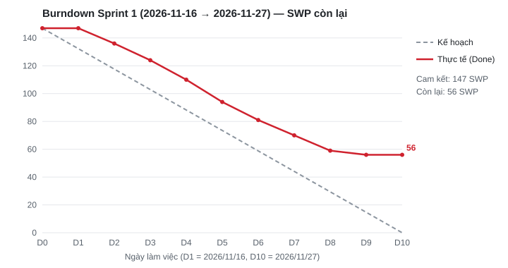

# Báo cáo tiến độ — Product B (Yuki Cold Logistics), Sprint 1

- **Iteration trên Project:** `Sprint 1` — field *Iteration* của [GitHub Project](https://github.com/users/linhnn-22575/projects/1)
  (lọc `iteration:"Sprint 1"` để xem đúng 36 sub-issue của sprint).
- **Khoảng thời gian giả lập:** 2026/11/16 (thứ Hai) → 2026/11/27 (thứ Sáu), 10 ngày làm việc. Iteration trên Project kéo tới 2026/11/29.
- **Ngày lập báo cáo:** 2026/11/27, cuối sprint. Số liệu đọc lại từ Project sau khi cập nhật, không phải từ bảng tính riêng.
- **Đội giả định:** BE 1, BE 2, FE 1, FE 2, QA 1, Infra/PM 1, BrSE 1. Mỗi người 6 giờ tập trung/ngày, nhận tối đa 30 SWP (60h theo
  quy ước 2h/SWP ở [estimate.md](estimate.md) §2).

> Đây là sprint **giả lập** cho bài LAB-5. Cách giả lập (chọn việc theo thứ tự phụ thuộc, tốc độ thực tế, các sự cố chèn vào) nằm
> trong [`output/sprint/simulate-sprint-1.py`](output/sprint/simulate-sprint-1.py); kết quả từng issue ở
> [`output/sprint/sprint-1-simulation.json`](output/sprint/sprint-1-simulation.json). Chạy lại cho cùng kết quả.

**Tóm tắt cho khách:** Sprint 1 cam kết 36 việc, 147 SWP. Hoàn thành 23 việc, **91 SWP (62%)**. Nền tảng (E1) xong 44/65 SWP nhưng migration sổ
tồn kho trễ 2 ngày. Phần giờ lái xe tải 2024 (E9) xong 14/30 SWP. Hai việc đang chờ phía khách: trả lời bộ Q&A và xác nhận pháp lý về
giới hạn giờ lái. Tốc độ thực tế chậm hơn kế hoạch khoảng 25%; nếu giữ tốc độ này, tổng Phase 1 cần khoảng 2.500h thay vì 1.994h.

## 1. Trạng thái

Sub-issue thuộc Sprint 1, theo field *Status* trên Project:

| Trạng thái | Số issue | Tổng SWP | Ghi chú |
|---|---:|---:|---|
| Done | 23 | 91 | Đã đóng issue. Gồm: migration nền ([#3](https://github.com/linhnn-22575/lab5-product-b-backlog/issues/3)), M_xx + tiếng Nhật ([#7](https://github.com/linhnn-22575/lab5-product-b-backlog/issues/7), [#8](https://github.com/linhnn-22575/lab5-product-b-backlog/issues/8)), 9 vai trò ([#10](https://github.com/linhnn-22575/lab5-product-b-backlog/issues/10), [#12](https://github.com/linhnn-22575/lab5-product-b-backlog/issues/12)), ngưỡng nhiệt có phiên bản ([#14](https://github.com/linhnn-22575/lab5-product-b-backlog/issues/14), [#15](https://github.com/linhnn-22575/lab5-product-b-backlog/issues/15)), hạ tầng Tokyo + CI ([#17](https://github.com/linhnn-22575/lab5-product-b-backlog/issues/17), [#18](https://github.com/linhnn-22575/lab5-product-b-backlog/issues/18)), bảng phiên bản quy tắc giờ làm ([#199](https://github.com/linhnn-22575/lab5-product-b-backlog/issues/199)), spec màn mới SCR-064 ([#250](https://github.com/linhnn-22575/lab5-product-b-backlog/issues/250)), bộ Q&A gửi khách ([#263](https://github.com/linhnn-22575/lab5-product-b-backlog/issues/263)), kịch bản test tích hợp ([#271](https://github.com/linhnn-22575/lab5-product-b-backlog/issues/271)) |
| In Review | 2 | 7 | Xong ngày cuối, PR chưa review: catalog tham số quy tắc giờ làm ([#200](https://github.com/linhnn-22575/lab5-product-b-backlog/issues/200)), xác nhận 7 điểm kiểm hàng nhập ([#82](https://github.com/linhnn-22575/lab5-product-b-backlog/issues/82)). Review sáng 2026/11/30 |
| In Progress | 3 | 21 | Migration sổ tồn kho [#4](https://github.com/linhnn-22575/lab5-product-b-backlog/issues/4) (35/40h, trễ); OIDC IdP công ty [#23](https://github.com/linhnn-22575/lab5-product-b-backlog/issues/23) (15/20h); làm rõ tồn kho [#105](https://github.com/linhnn-22575/lab5-product-b-backlog/issues/105) (2/8h) |
| Blocked | 2 | 4 | Chờ phía khách: phản ánh câu trả lời Q&A [#265](https://github.com/linhnn-22575/lab5-product-b-backlog/issues/265); xác nhận pháp lý OPS-LAW-01 về giới hạn giờ lái [#259](https://github.com/linhnn-22575/lab5-product-b-backlog/issues/259) |
| Todo | 6 | 24 | Chưa bắt đầu vì việc phụ thuộc chưa xong: [#5](https://github.com/linhnn-22575/lab5-product-b-backlog/issues/5), [#19](https://github.com/linhnn-22575/lab5-product-b-backlog/issues/19), [#20](https://github.com/linhnn-22575/lab5-product-b-backlog/issues/20) (chờ [#4](https://github.com/linhnn-22575/lab5-product-b-backlog/issues/4) / helper phân trang); [#201](https://github.com/linhnn-22575/lab5-product-b-backlog/issues/201), [#203](https://github.com/linhnn-22575/lab5-product-b-backlog/issues/203) (chờ [#200](https://github.com/linhnn-22575/lab5-product-b-backlog/issues/200) review); [#92](https://github.com/linhnn-22575/lab5-product-b-backlog/issues/92) (Infra hết giờ). Chuyển sang Sprint 2 |
| **Tổng Sprint 1** | **36** | **147** | Ngoài sprint: 183 sub-issue còn Todo trong backlog (850 SWP) |

Theo epic (cam kết → xong, SWP): E1 65 → 44 · **E9 giờ lái 2024 30 → 14** · E11 13 → 13 · E2 11 → 3 · E10 9 → 6 · E5 6 → 0 ·
E7 5 → 5 · E3 3 → 3 · E6 3 → 3 · E4 2 → 0.

Theo người (cam kết → xong SWP · giờ đã làm / 60h):

| Người | Cam kết | Xong | Giờ đã làm | Ghi chú |
|---|---:|---:|---:|---|
| BE 1 | 28 | 10 | 60 | Mất 35h cho migration [#4](https://github.com/linhnn-22575/lab5-product-b-backlog/issues/4) (kế hoạch 20h) |
| BE 2 | 29 | 19 | 60 | |
| FE 1 | 11 | 6 | 15 | Chỉ có việc ngày 3–5 (màn M_xx, sau khi API xong ngày 2); ngày 1–2 và 6–10 chờ API BE |
| FE 2 | 7 | 4 | 10 | Chỉ có việc ngày 6–7 (màn vai trò, chờ API xong ngày 5); còn lại chờ API BE |
| QA 1 | 13 | 13 | 32,5 | Chỉ viết test case và kịch bản; chưa có màn nào để chạy test |
| Infra/PM 1 | 30 | 18 | 60 | |
| BrSE 1 | 29 | 21 | 60 | |

## 2. Burndown

| Ngày | Ngày làm việc | Kế hoạch còn lại (SWP) | Thực tế còn lại (SWP) | Lệch |
|---|---|---:|---:|---:|
| D0 | 2026/11/16 đầu ngày | 147,0 | 147 | 0 |
| D1 | 2026/11/16 | 132,3 | 147 | +14,7 |
| D2 | 2026/11/17 | 117,6 | 136 | +18,4 |
| D3 | 2026/11/18 | 102,9 | 124 | +21,1 |
| D4 | 2026/11/19 | 88,2 | 110 | +21,8 |
| D5 | 2026/11/20 | 73,5 | 94 | +20,5 |
| D6 | 2026/11/23 | 58,8 | 81 | +22,2 |
| D7 | 2026/11/24 | 44,1 | 70 | +25,9 |
| D8 | 2026/11/25 | 29,4 | 59 | +29,6 |
| D9 | 2026/11/26 | 14,7 | 56 | +41,3 |
| D10 | 2026/11/27 | 0,0 | 56 | +56,0 |

"Thực tế còn lại" chỉ trừ SWP của issue đã Done; In Review chưa tính.

Thực tế lệch kế hoạch ở ba chỗ:

1. **Ngày 1 không giảm.** Mỗi người phải làm xong task đầu tiên trong hàng việc (7,5–15h thực tế) mới có task Done, nên task xong sớm nhất
   là ngày 2. Đây là hình dạng bình thường với task 4–16h, không phải dấu hiệu trễ.
2. **Lệch giữ ở mức khoảng 20 SWP từ D3 tới D6.** Nguyên nhân chính là migration [#4](https://github.com/linhnn-22575/lab5-product-b-backlog/issues/4):
   số dư sau migrate không khớp `qty_on_hand` của prototype, BE 1 phải chạy lại hai lần (40h thay vì 20h). Hai task xếp sau trong hàng việc
   của BE 1 ([#5](https://github.com/linhnn-22575/lab5-product-b-backlog/issues/5), [#19](https://github.com/linhnn-22575/lab5-product-b-backlog/issues/19))
   chưa bắt đầu được, kéo theo [#20](https://github.com/linhnn-22575/lab5-product-b-backlog/issues/20) của FE 2. Cùng lúc FE 1 và FE 2 ngồi
   chờ API phần lớn sprint.
3. **Lệch tăng mạnh hai ngày cuối (D9–D10).** Không có task nào xong ngày 10: hai task xong code ngày cuối còn chờ review
   ([#200](https://github.com/linhnn-22575/lab5-product-b-backlog/issues/200), [#82](https://github.com/linhnn-22575/lab5-product-b-backlog/issues/82)),
   hai task chờ khách ([#265](https://github.com/linhnn-22575/lab5-product-b-backlog/issues/265), [#259](https://github.com/linhnn-22575/lab5-product-b-backlog/issues/259)).
   Review dồn cuối sprint làm burndown trông tệ hơn khối lượng đã làm.

Tốc độ: task Done tốn trung bình **2,5h/SWP**, kế hoạch là 2h/SWP. Cả đội làm 297,5h trên 420h năng lực; 122,5h bỏ trống chủ yếu ở FE và QA.

## 3. Rủi ro trễ tiến độ

Các mốc dùng dưới đây là mốc giả định của kế hoạch Phase 1: **M1** Sprint 2 bắt đầu E4–E6 (2026/11/30) · **M2** xong nền tảng E1 + màn
quy tắc giờ làm SCR-016 (cuối Sprint 2, 2026/12/11) · **M3** cổng kiểm luật giờ lái trước khi công bố tuyến (Sprint 4, 2027/01/08) ·
**M4** phát hành Phase 1.

| Rủi ro | Issue | Ảnh hưởng tới mốc nào | Hành động | Ai làm, khi nào |
|---|---|---|---|---|
| Migration sổ tồn kho trễ: chặn trực tiếp API thẻ trang chủ và phiếu nhập; BE 1 kẹt nên bảng master và helper phân trang chưa bắt đầu | [#4](https://github.com/linhnn-22575/lab5-product-b-backlog/issues/4) (In Progress) chặn [#32](https://github.com/linhnn-22575/lab5-product-b-backlog/issues/32), [#71](https://github.com/linhnn-22575/lab5-product-b-backlog/issues/71); [#5](https://github.com/linhnn-22575/lab5-product-b-backlog/issues/5), [#19](https://github.com/linhnn-22575/lab5-product-b-backlog/issues/19) chưa bắt đầu | M1 (E4 nhập hàng bắt đầu muộn 2–3 ngày); M2 nếu kéo dài | Xong [#4](https://github.com/linhnn-22575/lab5-product-b-backlog/issues/4) trong ngày 1 Sprint 2, BE 2 review chéo script đối soát số dư. Chuyển [#5](https://github.com/linhnn-22575/lab5-product-b-backlog/issues/5) sang BE 2 để chạy song song | BE 1 + BE 2, trước 2026/12/01 |
| Khách chưa trả lời bộ Q&A (15 câu, 5 câu chặn BE: B01, B02, B03, B09, B14) | [#265](https://github.com/linhnn-22575/lab5-product-b-backlog/issues/265) (Blocked), gửi từ [#263](https://github.com/linhnn-22575/lab5-product-b-backlog/issues/263) | M1 (pipeline phân bổ E6 dùng B01/B02), sau đó M4 nếu phải làm lại | Nhắc trong họp tuần với khách 2026/11/30. Nếu tới 2026/12/02 chưa có trả lời: làm theo giả định ở [PREMISE.md](PREMISE.md) §2, đánh dấu issue có thể phải sửa, báo khách chi phí sửa nếu câu trả lời khác giả định | BrSE 1 nhắc khách; Infra/PM 1 báo leo thang, 2026/12/02 |
| Chưa có xác nhận pháp lý giới hạn giờ lái (OPS-LAW-01, Q&A-B06: 960h/năm, 3.300h/năm, 284h/tháng…) | [#259](https://github.com/linhnn-22575/lab5-product-b-backlog/issues/259) (Blocked); ảnh hưởng [#227](https://github.com/linhnn-22575/lab5-product-b-backlog/issues/227) cổng công bố, [#239](https://github.com/linhnn-22575/lab5-product-b-backlog/issues/239) báo cáo tuân thủ | **M3** — không được bật chặn công bố tuyến khi chưa chốt giá trị pháp lý | Gửi văn bản đề nghị khách xác nhận, hạn 2026/12/11. Code vẫn làm tiếp vì mọi giới hạn đọc từ bảng `driver_rule_versions` (ADR-006); nếu khách đổi giá trị chỉ cần tạo phiên bản quy tắc mới, không sửa code | Infra/PM 1 gửi 2026/12/01; BrSE 1 theo dõi tới 2026/12/11 |
| FE và QA thiếu việc, BE là nút cổ chai (FE dùng 25/120h, QA 32,5/60h) | Các màn E2/E9 chờ API: [#201](https://github.com/linhnn-22575/lab5-product-b-backlog/issues/201) → [#203](https://github.com/linhnn-22575/lab5-product-b-backlog/issues/203), [#19](https://github.com/linhnn-22575/lab5-product-b-backlog/issues/19) → [#20](https://github.com/linhnn-22575/lab5-product-b-backlog/issues/20) | M2 và M4 (đội chỉ đạt 71% năng lực) | Sprint 2: BE làm API mà FE đang chờ trước. FE dựng màn theo hợp đồng API đã có trong spec bằng dữ liệu giả, nối API khi BE xong. QA viết test case cho E2/E3/E9 trước khi có màn | Infra/PM 1 trong buổi lập kế hoạch Sprint 2, 2026/11/30 |
| Tốc độ thực tế 2,5h/SWP so với kế hoạch 2h/SWP | Toàn backlog (850 SWP còn lại) | M4 — tổng Phase 1 khoảng 2.500h thay vì 1.994h (+25%) | Chưa đổi hệ số sau 1 sprint. Sau Sprint 2 có đủ 2 sprint số liệu thì tính lại hệ số, cập nhật field *Estimate (h)* cho toàn backlog và báo khách nếu ngày phát hành dịch | Infra/PM 1, 2026/12/11 |
| Breakdown thiếu phụ thuộc: task test tích hợp và UAT không khai báo phụ thuộc vào task tính năng, có thể bị kéo vào sprint quá sớm | [#272](https://github.com/linhnn-22575/lab5-product-b-backlog/issues/272), [#274](https://github.com/linhnn-22575/lab5-product-b-backlog/issues/274), [#275](https://github.com/linhnn-22575/lab5-product-b-backlog/issues/275) | Lập kế hoạch các sprint sau | Rà `depends_on` của E11, thêm dòng "Blocked by" vào thân issue. Sprint 1 đã giữ các task này ngoài sprint | QA 1 + BrSE 1, 2026/11/30 |
| Review dồn cuối sprint | [#200](https://github.com/linhnn-22575/lab5-product-b-backlog/issues/200), [#82](https://github.com/linhnn-22575/lab5-product-b-backlog/issues/82) | Ít; làm burndown khó đọc | Đặt giới hạn: PR mở quá 1 ngày thì người review được chỉ định phải xử lý trong ngày | Cả đội, áp dụng từ Sprint 2 |

**Đề xuất cho Sprint 2 (2026/11/30 → 2026/12/11):** mang sang 13 việc chưa xong (56 SWP). Cam kết khoảng 120 SWP thay vì 147, vì tốc độ thật
khoảng 2,5h/SWP. Ưu tiên theo thứ tự: xong E1, API cho màn SCR-016 (E9), sau đó bắt đầu pipeline phân bổ S6.1 ([#107](https://github.com/linhnn-22575/lab5-product-b-backlog/issues/107)).
